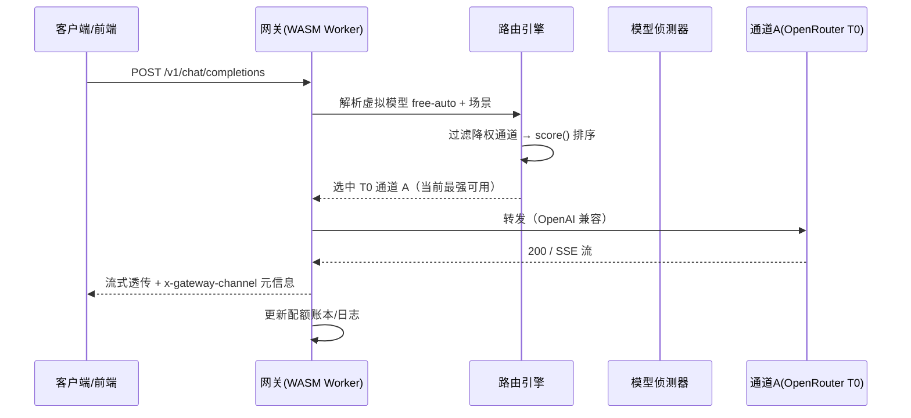
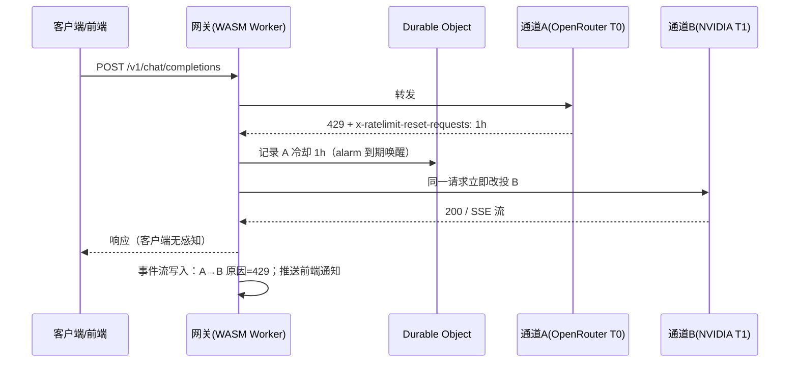
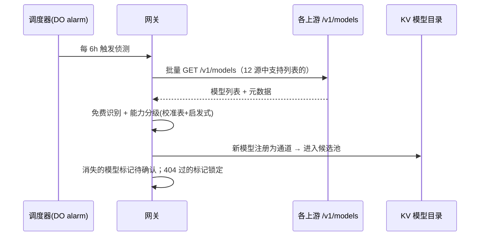

# 免费资源 AI 智能聚合网关 产品需求文档（PRD）

| 项目 | 内容 |
| --- | --- |
| 版本 | v2.0 |
| 日期 | 2026-10-19 |
| 状态 | 待评审 |
| 核心技术参考 | [openai-oxide](https://github.com/fortunto2/openai-oxide)（MIT，Rust + WASM） |
| 路由设计参考 | Routiform Auto-Combo 引擎（6 因子评分 + 熔断 + 自愈） |
| 输入文档 | 《大厂llm免费资源对接.pdf》（4 海外源 + 8 国内源） |
| 关键词 | WASM、Cloudflare Workers、免费额度聚合、智能路由、限流降权、类 Agent 前端、模型自动侦测 |

---

## 1. 背景与问题

### 1.1 免费资源全景（输入文档最新版）

文档盘点了 **12 个可用免费资源**，分海外与国内两类：

**海外源（4 个）**

| 资源 | 免费额度 | 能力/稳定性特征 | 聚合层定位 |
| --- | --- | --- | --- |
| **OpenRouter** | 20+ `:free` 模型；基础 20 RPM / 50 RPD，充值 $10 后账户级永久 1,000 RPD | 无 SLA，可能超时/冷却；同一模型背后多家上游，**内置自动故障转移** | 广度入口（默认） |
| **NVIDIA NIM** | 每模型 40 RPM（按模型独立计算）；9 个 slug 级联理论 ≈360 RPM | 无 SLA，高峰 p99 可达数百秒 | 高吞吐批量层（额度最宽裕） |
| **Groq** | llama-3.1-8b 14,400 RPD；llama-3.3-70b 1,000 RPD / 30 RPM；qwen3-32b、kimi-k2 60 RPM / 1,000 RPD | LPU 硬件，70B ≈320 tokens/s，延迟确定性最强 | 速度专用通道（交互场景） |
| **Cloudflare Workers AI** | 每天 10,000 Neurons | 边缘网络可用性基线高；大模型需付费计划 | 轻量/嵌入补充通道 |

**国内源（8 个，新增）**

| 资源 | 免费额度 | 能力特征 | 聚合层定位 |
| --- | --- | --- | --- |
| **智谱 GLM-4.7-Flash** | 完全免费；新用户注册送 2,000 万 Token | 200K 上下文，OpenAI 兼容 | 国内高质量主力 |
| **字节豆包 doubao-lite** | 据报告完全免费无限制；火山引擎每月赠 100 万 Token | 轻量 | 国内轻量容量 |
| **百度文心 ERNIE-Speed/Lite** | 长期免费但限速；QPS ≤ 50 免费 | 轻量 | 国内容量补充 |
| **阿里云百炼** | 新用户送 7,000 万 Token（90 天）；70+ 模型，每模型独立 100 万 | Qwen 系列全家桶 | 国内广度入口 |
| **硅基流动 SiliconFlow** | 注册实名送 16 元；≤10B 模型 0 元永久免费（Qwen2.5-7B、DeepSeek-R1-Distill-7B） | 开源小模型 | 国内低成本推理 |
| **Kimi** | 免费版 1,000 次/月；注册送 15 元（3 个月） | 256K 上下文 | 长文本补充 |
| **MiniMax** | MiniMax-M3 约 20 RPM / 100 万 TPM | — | 国内补充 |
| **腾讯混元** | 个人开发者每月 100 万 Token；微信小程序"成长计划"可申请 10 亿 Token | — | 国内补充 |

### 1.2 核心问题

1. **额度碎片化**：12 个源各自独立的 RPM/RPD/Token 限制，单源直连迟早撞墙（如 OpenRouter 免费层 50 RPD 一天见底、Kimi 每月仅 1,000 次）。
2. **切换靠人工**：429 限流、日限额耗尽、上游抖动时，需要人工改客户端配置换源，体验断裂。
3. **接入成本高**：每个工具（Cursor / Cline / Claude Code / 自研应用）都要单独配 Key 和 Base URL。
4. **国内外网络差异**：海外源在国内访问需要代理且延迟高；国内源在海外边缘访问反向不稳——**单一部署位置无法同时吃满 12 个源**。
5. **最优源不固定**：能力、延迟、额度余量随时间变化，靠人工调度不可持续。

### 1.3 输入文档给出的组合策略（产品策略输入）

> OpenRouter 默认 → 命中 429 或额度耗尽，回退 NVIDIA NIM 级联（批量）或 Groq（交互）。

本产品要把这条策略**自动化、智能化**，并通过 WASM 边缘技术把网关本身也跑在免费额度上。

---

## 2. 产品定位与目标

### 2.1 一句话定位

**一个基于 Rust→WASM 的边缘 AI 聚合网关：对内聚合 12 个免费 LLM 资源（可扩展），对外只暴露一个 OpenAI 兼容端点 + 一个类 Agent 的聊天前端；智能路由优先使用能力最强的模型，被降权（限流/故障）后自动切换到下一个可用通道，客户端全程无感知。**

### 2.2 产品目标

| 目标 | 衡量指标 |
| --- | --- |
| 客户端零改造成本 | 任何 OpenAI 兼容工具只改 `base_url` + `key` 即可接入 |
| 免费额度利用率最大化 | 相比单源直连，综合有效吞吐 ≥ 3 倍（NVIDIA 9 slug 级联 + 12 源互补） |
| 服务不中断 | 任一上游 429/5xx/超时，客户端可见错误率 < 1%；24h 连续运行无人工干预 |
| 智能选路 | 默认路由到当前**能力档位最高**的可用通道；降权后自动切换，冷却结束探测恢复 |
| 模型自动侦测 | 上游模型列表自动同步、能力自动分级、候选池自动生成，新模型零配置入池 |
| 网关自身零成本 | 网关运行在 Cloudflare Workers 免费额度（10 万请求/天）上 |

### 2.3 非目标（Out of Scope）

- 不做付费中转、计费、多租户 SaaS。
- 不接管 OAuth 订阅类源（Claude Code / Copilot 等），第一期仅 API Key 类免费源。
- 不做模型训练/微调，仅做推理网关。

---

## 3. 用户画像与典型场景

| 用户 | 诉求 | 典型场景 |
| --- | --- | --- |
| 个人开发者 | 免费、稳定用上大模型 | Cursor / Cline 编程助手全天在线；日常问答 |
| 批量任务执行者 | 把免费额度"用尽" | 文档摘要、数据清洗等可排队任务，NVIDIA 级联灌满 ~360 RPM |
| Agent 应用玩家 | 类 Agent 的对话体验 | 自带 Web UI 直接对话，流式 + 工具调用 + 多轮任务 |
| 自托管玩家 | 统一管理多 Key、可观测 | Dashboard 看每个源的剩余额度、成功率、延迟 |

**场景定义（供路由策略与前端模式切换使用）：**

- **S1 交互场景**：`stream: true` 且上下文较短 → 首选 **Groq**（速度确定性）+ 可选对冲双发。
- **S2 批量场景**：可排队、容忍数百秒延迟 → 首选 **NVIDIA NIM 级联**（吞吐最大）。
- **S3 质量场景**：默认 → 首选 **OpenRouter**（广度 + 内置故障转移）+ 智谱 GLM（国内直连）。
- **S4 轻量场景**：嵌入、分类、ASR → 路由 **Cloudflare Workers AI**（whisper、嵌入）。

---

## 4. 参考项目 openai-oxide 技术借鉴分析

openai-oxide 是"1:1 对标 openai-python 的 Rust 客户端"，其核心价值是**一个 Rust 核心编译到所有平台**（native / Node napi-rs / Python PyO3 / **WASM wasm32-unknown-unknown**），流式、重试、限流追踪、WebSocket 连接池全平台一致。本项目借鉴其以下机制：

| openai-oxide 组件 | 本项目借鉴点 |
| --- | --- |
| **Rust 核心 → `wasm32-unknown-unknown`** | 网关主体编译为 WASM 部署到 **Cloudflare Workers**（同时 Workers AI 本身就是一个免费资源源）；同一核心也可编译为 native 二进制部署国内 VPS，实现"一次编写、两地部署" |
| `src/runtime.rs` 跨平台原语 | `sleep`（native: tokio / WASM: gloo-timers）、`spawn`、`timeout`（WASM 用 AbortSignal）三套抽象，以及**指数退避 0.5s × 2ⁿ 封顶 60s** 直接作为降权冷却曲线 |
| `src/rate_limit.rs` 中间件 | 从响应头解析 `x-ratelimit-limit-requests/tokens`、`x-ratelimit-remaining-*`、`x-ratelimit-reset-requests`（支持 "1s" / "1m20s" 格式）→ 生成本产品**配额账本**的信号源，软降权与冷却时长均由它驱动 |
| `src/streaming.rs` | 增量 SSE 解析器 + 防缓冲头（`Accept: text/event-stream`、`Cache-Control: no-cache`）→ 网关流式透传层 |
| `src/hedged.rs` | **对冲请求**：同请求发 N 份、取最快、取消慢者（Google "Tail at Scale" 论文，p99 降 50–96%，额外 token 成本 2–7%）→ 交互场景可选开启 |
| `src/cloudflare.rs` | Workers AI OpenAI 兼容 base URL、`x-session-affinity` 前缀缓存头、**Cloudflare AI Gateway `cf-aig-*` 头**（超时/重试次数/退避策略/缓存 TTL/自定义缓存键）→ 网关可叠加 CF 官方网关能力 |
| `src/openrouter.rs` | OpenRouter base URL + `http-referer` / `x-openrouter-title` 归属头 |
| Feature gating + `default-features = false` | WASM 编译时只编入需要的端点（chat / embeddings / models），**压缩 wasm 体积与 Workers 冷启动/CPU 耗时** |
| Struct Outputs / Stream FC early parse | 类 Agent 前端的结构化输出与工具调用早解析（`arguments.done` 即时执行本地工具） |

### 4.1 WASM 已知限制与对策（来自 openai-oxide 官方文档 + Workers 平台约束）

| 限制 | 影响 | 本产品的对策 |
| --- | --- | --- |
| WASM 中**流式重试未实现** | 流式请求中途失败无法自动重试 | 重试状态机下沉到 **Durable Object**（有 alarms 可延时唤醒）；或约定"首包前失败可重试、已吐字不切换" |
| WASM 无 timer/timeout 原语 | 冷却调度、延迟探测无法在请求线程里 sleep | 冷却/熔断状态用 **DO + alarms** 调度；请求级超时用 `AbortController` |
| 无 multipart 上传 | 音频文件上传受限 | whisper 转写场景改为传 bytes；文档置为 P2 |
| 无 SIMD / gzip / HTTP2 | 大 payload 解析与传输优化受限 | Workers 运行时处理 gzip/HTTP2；JSON 解析用 serde 轻量路径 |
| Workers 免费额度 CPU 10ms/请求 | 单请求 CPU 超限 | feature gating 精简 wasm；重活下沉 DO；网关自身逻辑保持 O(1) 决策 |
| 海外边缘访问国内源延迟不稳 | 智谱/豆包等国内源从海外 Workers 访问延迟高 | **双部署模式**：边缘模式（吃海外源）+ 国内 VPS native 模式（吃国内源），同一 Rust 核心两处编译，路由账本按部署位置分片 |

### 4.2 与 Routiform 设计的关系

路由与韧性设计（能力分级、6 因子评分、熔断、探测恢复、事件流）沿用上一版 Routiform 启发的方案，但**工程底座从 Next.js/TS 换成 Rust→WASM**：oxide 的 `rate_limit.rs` + `runtime.rs` 正好提供了评分引擎所需的限流信号与退避原语，无需从零造轮子。

---

## 5. 系统架构设计

### 5.1 总体架构（边缘 WASM 模式）

```
┌──────────────────────────────────────────────────────────────┐
│                    用户浏览器                                  │
│        类 Agent 前端 SPA（可 WASM 编译，可选 Dioxus/Leptos）     │
│   流式聊天 · 工具调用卡片 · 推理展示 · 模型面板 · 降权通知         │
└───────────────────────────┬──────────────────────────────────┘
                            │ HTTPS（网关签发的 Key）
                            ▼
┌──────────────────────────────────────────────────────────────┐
│           Cloudflare Workers（网关，Rust 核心 → wasm32）        │
│  ┌─────────────┐ ┌─────────────┐ ┌──────────────┐ ┌─────────┐ │
│  │ 统一 API 层  │ │ 智能路由引擎 │ │  模型侦测器   │ │ Provider│ │
│  │ /v1/* OpenAI│ │ 能力分级+评分│ │ 定时探测 /models│ │ 执行器  │ │
│  │ 兼容·SSE流式│ │ 降权/熔断/探测│ │ 自动分级/入池  │ │ ×12源   │ │
│  └─────────────┘ └─────────────┘ └──────────────┘ └─────────┘ │
│  ┌─────────────┐ ┌─────────────┐ ┌──────────────┐            │
│  │  配额账本    │ │  对冲(可选)  │ │  静态资源托管  │            │
│  │ x-ratelimit │ │ hedged双发  │ │ 前端 SPA      │            │
│  └─────────────┘ └─────────────┘ └──────────────┘            │
└──────────┬───────────────────┬───────────────────────────────┘
           │ Durable Objects   │ KV / D1
           │ (通道状态机+alarms)│ (模型目录/配置/用量日志/事件流)
           ▼                   ▼
     OpenRouter  NVIDIA×9  Groq  Cloudflare  ← 海外源（边缘直连）
     智谱 豆包 文心 百炼 硅基流动 Kimi MiniMax 混元 ← 国内源
     （国内源由国内 VPS native 部署节点优先承接，见 5.2）
```

### 5.2 双部署模式（同一 Rust 核心）

| 模式 | 编译目标 | 部署位置 | 承接的源 | 说明 |
| --- | --- | --- | --- | --- |
| **边缘模式** | `wasm32-unknown-unknown` → Cloudflare Workers | 海外边缘 | OpenRouter / NVIDIA / Groq / CF Workers AI | 网关自身跑在 CF 免费额度；海外源零中转 |
| **本土模式** | native（x86_64/arm64）→ Docker | 国内 VPS | 智谱 / 豆包 / 文心 / 百炼 / 硅基流动 / Kimi / MiniMax / 混元 | 国内源直连低延迟；不依赖代理 |
| 联邦 | 两侧通过账本同步 API 交换配额/健康状态 | — | 智能路由在客户端侧（前端）或入口侧做**位置感知选路**：国内客户端 → 本土节点优先，海外/代理客户端 → 边缘节点优先 | 一期可简化为两个独立入口，二期做联邦 |

### 5.3 核心概念模型

- **Provider（源）**：一个上游厂商，含 Base URL、Key、模型列表探测能力。
- **通道（Channel）**：`Provider × Model Slug` 的最小计费/熔断单元。NVIDIA 的 9 个 slug = 9 个独立通道（各 40 RPM）。
- **虚拟模型（Virtual Model）**：对客户端暴露的名字：`free-auto` / `free-strong` / `free-fast` / `free-batch` / `free-embed`。
- **配额账本（Quota Ledger）**：每通道当日已用 RPM/RPD、剩余量、重置时间（从 `x-ratelimit-*` 响应头学习）。
- **能力分级（Capability Tier）**：T0/T1/T2，"先选能力强的"的排序基础。
- **场景（Scene）**：交互 / 批量 / 质量 / 轻量，决定模式包与通道加权。

---

## 6. 功能需求详述

### F1 统一网关 API（P0）

| 编号 | 需求 | 验收标准 |
| --- | --- | --- |
| F1.1 | OpenAI 兼容 `POST /v1/chat/completions`，流式 SSE + 非流式 | Cursor/Cline/任意 OpenAI SDK 直接可用 |
| F1.2 | `POST /v1/embeddings` | 返回标准 embeddings 结构 |
| F1.3 | `GET /v1/models` 列出虚拟模型目录（含能力档位说明） | 客户端可枚举 |
| F1.4 | 流式透传：增量 SSE 解析 + 防缓冲头 + 首包不缓冲、断连即取消上游（AbortController） | 流式延迟与直连无感知差异 |
| F1.5 | 请求头透传 `X-Gateway-Mode: auto/interactive/batch/embed` | 场景分流入口 |

### F2 Provider 接入与模型自动侦测（P0，核心差异化）

> "侦测集自动选择"：网关自己发现有哪些模型可用、各自什么能力，自动生成路由候选池。

| 编号 | 需求 | 验收标准 |
| --- | --- | --- |
| F2.1 | 内置 12 源注册表（4 海外 + 8 国内），填 Key 即用；每个源可配多 Key | 一键连通性测试 |
| F2.2 | **模型目录侦测**：启动 + 每 6h 增量调用上游 `GET /v1/models`（OpenRouter/Groq/NVIDIA/百炼/硅基流动/智谱等支持列表的源）；不支持列表的源（豆包/文心/Kimi/MiniMax/混元/CF）用内置静态目录 | 上游新增免费模型自动出现在目录 |
| F2.3 | **免费模型识别**：slug 含 `:free`、价格=0、内置免费清单（如 GLM-4.7-Flash、doubao-lite、ERNIE-Speed/Lite、≤10B SiliconFlow 模型） | 免费模型自动标记 |
| F2.4 | **能力自动分级**：内置校准表 + 名称启发式（`ultra/super/70b/120b/32b` → 高档；`instant/lite/flash/mini/turbo/speed` → 低档；`whisper` → 转写专用）+ 上游元数据（context_length） | 新模型入池即带 tier 标签 |
| F2.5 | **自动建通道**：侦测到的新免费模型自动注册为通道进入候选池（可配置"自动/人工确认"两种模式） | 零配置入池 |
| F2.6 | 自定义 OpenAI 兼容源（Base URL + Key + 手工目录） | 未来接入新免费源零代码 |
| F2.7 | 通道剔除：404 模型下线 → permanent-lockout 自动移出候选池；上游列表消失 → 标记待确认 | 目录不腐烂 |

### F3 智能路由引擎（P0，核心）

> 设计原则：**先选能力最强的；被降权后换一个；冷却结束探测恢复。**

#### F3.1 能力分级初始校准表（T0/T1/T2）

| 档位 | 模型示例（来自输入文档） |
| --- | --- |
| T0 | Nemotron 3 Ultra (550B)、Nemotron 3 Super、Llama 3.3 70B、gpt-oss-120b、Qwen3-30B-A3B、GLM-4.7-Flash、DeepSeek R1 Distill、Gemini 2.0 Flash Exp、Mixtral 8x22B |
| T1 | Llama 4 Scout/Maverick、Qwen3-14B/8B、glm-5-3、nemotron-3.5-lightning、deepseek-v4.1-flash、gemma-3-12b |
| T2 | llama-3.1-8b 系列、qwen2.5-coder、Qwen2.5-7B、DeepSeek-R1-Distill-7B、whisper（转写专属）、ernie-lite |

#### F3.2 通道评分函数（借鉴 Auto-Combo 6 因子，"能力优先"标定）

```
score(channel) = w_cap     × 能力档位分（T0=1.0, T1=0.6, T2=0.3）
               + w_quota   × 剩余配额归一化 [0..1]   ← rate_limit.rs 提供信号
               + w_health  × 熔断健康度（CLOSED=1.0, HALF=0.5, OPEN=0.0）
               + w_latency × p95 延迟倒数归一化
               + w_stab    × 近期成功率
               + w_scene   × 场景匹配度（交互/批量/质量/轻量）
```

| 因子 | 默认权重 | 说明 |
| --- | --- | --- |
| cap（能力） | **0.30** | "先选能力强的"核心权重 |
| quota（剩余额度） | 0.25 | 引导流量避开即将耗尽的通道 |
| health（健康） | 0.20 | 熔断器状态 |
| latency（延迟） | 0.10 | p95 统计 |
| scene（场景） | 0.10 | S1 交互给 Groq 加分，S2 批量给 NVIDIA 加分，国内客户端给国内源加分 |
| stab（稳定性） | 0.05 | 成功率方差 |

**模式包（Mode Pack）一键切换（前端可切）：**

| 模式包 | 关键权重 | 适用 |
| --- | --- | --- |
| Quality First（默认） | cap=0.45 | 问答、代码等质量优先 |
| Ship Fast | latency=0.35 | IDE 交互、实时对话 |
| Batch Throughput | quota=0.45 | 离线批量，配合 NVIDIA 级联 |

#### F3.3 选路流程（每次请求）

```
1. 解析虚拟模型 + 场景（X-Gateway-Mode 或自动判定）→ 候选通道集 C
2. 过滤：剔除 OPEN 熔断 / 冷却中 / 永久锁定的通道
3. 按 score(C) 降序排序
4. 取第一名尝试；失败进入降级循环（F3.4）
5. C 全部不可用 → 跨档降级（更低 Tier 候选池）→ 仍失败返回错误
6. 记录选路决策到请求日志（可解释）
```

#### F3.4 降权与切换（"被降权后换一个"的完整定义）

| 触发条件 | 判定 | 动作 |
| --- | --- | --- |
| HTTP 429 | 限流 | **优先解析 `Retry-After` / `x-ratelimit-reset-*` 头**（rate_limit.rs 格式）→ 通道冷却至重置时间；无头则指数退避 0.5s×2ⁿ 封顶 60s |
| 429 且日限额耗尽（RPD 用尽） | 本日降权 | 冷却至次日额度重置时间 |
| HTTP 5xx / 超时 / 连接错误 | 临时故障 | 记一次失败；连续失败 N 次（默认 3）→ 熔断 OPEN（30s，DO alarm 唤醒） |
| 模型下线（404） | 永久剔除 | permanent-lockout，移出候选池，不自动恢复 |
| 401/403 Key 失效 | 账户级故障 | 该 Key 账户降权，同源其他 Key 继续 |

**切换语义**：触发降权后，**同一请求立即在候选集中改投下一名**，不向客户端返回错误；流式已开始吐字则不切换（防内容撕裂）；每次切换写入事件流并推送到前端（见 F5）。

#### F3.5 探测恢复（Recovery）

- 冷却到期（DO alarm 唤醒）→ HALF_OPEN：放行 1 个探测请求（缩短超时）。
- 探测成功 → 恢复 CLOSED，权重复位，流量回迁高档通道；失败 → 冷却延长（×2，封顶 30min）。

#### F3.6 配额账本与软降权（Quota Ledger）

- 每通道维护：当日已用 RPM/RPD、`x-ratelimit-remaining-*`、下次重置时间。
- **软降权**：已用 RPD ≥ 80% → 提前降低该通道权重分流，避免 429 打门。
- **NVIDIA 级联**：9 个 slug 独立记账，fill-first 填充，40 RPM/模型用满到 ≈360 RPM。
- **Token 制源**（百炼 90 天/每模型 100 万、混元月度、GLM 新用户 2000 万）：按 token 桶记账，同步纳入 quota 因子。

#### F3.7 对冲请求（Hedged，P1，可选）

- 交互场景（S1）且目标通道额度充裕时，可对对冲窗口（默认 p95 ≈1.5s）后未出首包的请求**双发到同档位第二通道**，取先出首包者、取消另一路。
- 借鉴 oxide `hedged.rs`；额外 token 成本 2–7%，**仅对低延迟敏感且非流式或首包前窗口启用**，默认关闭、按模式包开关。

#### F3.8 探索（Exploration）

- 5% 流量随机探询低分通道（bandit），感知新入池模型；全部通道 OPEN（incident 模式）时自动关闭探索。

### F4 场景分流策略（P1）

| 场景 | 判定 | 路由倾向 |
| --- | --- | --- |
| S1 交互对话 | `stream: true` 且上下文 < 32k | Ship Fast → Groq 优先；可选对冲 |
| S2 批量任务 | `X-Gateway-Mode: batch` 或无 stream | Batch Throughput → NVIDIA 级联填充 |
| S3 嵌入/ASR | `/v1/embeddings` 或 whisper 模型 | Cloudflare Workers AI |
| 国内客户端 | 入口 IP/节点判定 | 本土节点优先（智谱/百炼/豆包） |
| 默认 | 其他 | Quality First → OpenRouter 广度入口 |

### F5 类 Agent 前端页面（P0）

> 产品自带 Web 聊天界面，形态对标 Cursor / Copilot / Claude 的 Agent 对话体验，是"聚合网关"面向个人用户的直接入口。

#### F5.1 整体布局

```
┌────────────────────────────────────────────────────────┐
│ 顶栏：模式包切换（质量/速度/批量）· 网关状态徽章 · Key   │
├──────────┬─────────────────────────────┬──────────────┤
│ 会话列表  │  主聊天区                    │ 模型/通道面板 │
│ - 会话1  │  ┌──────────────────────┐  │ · 当前模式:   │
│ - 会话2  │  │ Assistant（流式输出）  │  │   自动侦测    │
│ + 新会话  │  │ [推理过程 ▾]          │  │ · 实际通道:   │
│          │  │ [工具调用卡片]         │  │   Groq·70b    │
│          │  │ [代码块/高亮/MD渲染]   │  │ · 剩余额度    │
│          │  └──────────────────────┘  │ · 降权事件    │
│          │  [输入框 + 场景/模型选择]    │ │              │
└──────────┴─────────────────────────────┴──────────────┘
```

#### F5.2 功能需求

| 编号 | 需求 | 验收标准 |
| --- | --- | --- |
| F5.1 | **会话式聊天**：多轮对话、流式输出、Markdown/代码高亮渲染、停止生成、重新生成 | 体验对标主流 Chat UI |
| F5.2 | **Agent 元素**：工具调用卡片（函数名 + 参数 + 结果，支持 Stream FC 早解析逐步展示）、多轮任务执行、推理过程（reasoning）折叠展示 | 类 Agent 交互完整 |
| F5.3 | **模型选择：侦测集自动选择（默认）**：模式为 `自动`时，由网关按 F2/F3 自动选路；面板实时显示"本次回答实际使用的源 · 模型 · 档位"（透明化） | 每次回复可追溯来源 |
| F5.4 | **手动覆盖**：下拉可锁定虚拟模型（free-auto/strong/fast/batch/embed）或具体通道（高级模式） | 覆盖后按锁定通道路由 |
| F5.5 | **降权事件通知**：内联提示 + toast，如"OpenRouter 触发 429 限流 → 已自动切换至 NVIDIA NIM（llama-3.3-70b）"，附带本次会话的切换历史 | 用户对"被降权后换一个"有感 |
| F5.6 | **模式包切换**：质量优先 / 速度优先 / 批量吞吐，一键切换评分权重 | 切换即时生效 |
| F5.7 | **会话管理**：历史会话列表、搜索、继续对话、删除；会话与服务端上下文持久化 | 刷新不丢 |
| F5.8 | **文件输入**：拖拽/粘贴代码与文档片段进输入框（文本类；音频上传受 WASM 限制走 bytes，P2） | 常见 Agent 输入方式 |
| F5.9 | **用量小面板**：今日 tokens / 请求数、各源消耗占比、当前场景 | 用户感知额度消耗 |
| F5.10 | **响应式 + 暗色模式**；前端可 WASM 编译（Dioxus/Leptos）或 SPA 静态资源托管于 Workers Assets | 移动端可用 |

#### F5.3 前端与网关的交互

- 前端使用网关签发的客户端 Key 直接调 `/v1/chat/completions`（stream）。
- 每次回复的 SSE 首帧携带网关注入的 `x-gateway-channel` 元信息头（源、模型、档位、切换事件），前端渲染"来源徽章"。
- 前端可用 EventSource/WebSocket 订阅事件流，实时刷新降权事件与通道健康。

### F6 可观测性（P1）

| 编号 | 需求 |
| --- | --- |
| F6.1 | 请求日志：通道 / 模型 / 延迟 / 状态 / 用量 / 失败原因 / 选路决策 |
| F6.2 | 用量面板：按源、按模型、按日的 tokens / 请求数 / 成功率 |
| F6.3 | 延迟面板：p50/p95/p99（整体 + 分通道） |
| F6.4 | 健康面板：每通道剩余额度、冷却剩余时间、熔断状态、近期错误 |
| F6.5 | 降权事件流：每次自动切换记录「原通道 → 新通道 + 原因」，可查询、可订阅 |

### F7 管理面（P1）

| 编号 | 需求 |
| --- | --- |
| F7.1 | Web Dashboard：Provider 管理、模型目录（侦测结果）、通道健康、用量、日志、模式包 |
| F7.2 | CLI：`gateway provider add/test`、`gateway status`、`gateway usage`、`gateway logs`、`gateway detect`（触发一次模型侦测） |
| F7.3 | 管理 API（Bearer 鉴权）：配置 CRUD，便于脚本化 |
| F7.4 | 客户端 API Key 管理：签发 / 吊销 / 按 Key 限流 / 按 Key 用量隔离 |

### F8 安全与可靠性（P0）

| 编号 | 需求 |
| --- | --- |
| F8.1 | 网关对外 API Key 鉴权；上游 Key 加密存储（Workers Secrets / 加密卷） |
| F8.2 | 客户端限流：按 Key RPM/RPD，防止单个客户端打爆上游免费额度 |
| F8.3 | 敏感信息脱敏：日志不记录 Key；完整 prompt 落盘可配置 |
| F8.4 | 网络策略：本土模式国内源直连；边缘模式访问国内源需显式开启并提示延迟风险 |
| F8.5 | 冷启动恢复：通道状态 / 冷却 / 熔断 / 配额账本持久化（DO/KV），重启不丢降权记忆 |

---

## 7. 核心流程时序图

### 7.1 正常请求（自动侦测 → 能力最强通道）



### 7.2 限流降权与自动切换



### 7.3 模型侦测与自动入池



---

## 8. 数据模型（Workers KV / Durable Objects / D1）

| 存储 | 实体 | 关键字段 |
| --- | --- | --- |
| KV | `provider:{id}` | name, type, base_url, key_ref(Secrets), enabled |
| KV | `model_catalog` | 侦测出的模型目录：slug, provider, tier, is_free, context_length, auto_registered_at |
| KV | `virtual_models` | name, description, candidate_rule(JSON), mode_pack |
| DO（每通道一个） | 通道状态机 | circuit(closed/half/open), cooldown_until, fail_streak, today_requests, today_tokens, reset_at, remaining(from x-ratelimit-*), weight |
| DO | 调度 | alarms：侦测周期、冷却到期唤醒、探测恢复 |
| D1 | `request_logs` | ts, client_key, virtual_model, channel, model_slug, latency_ms, status, tokens, fallback_from, error_class |
| D1 | `events` | 降权事件：ts, from_channel, to_channel, reason(429/5xx/timeout/lockout), detail |
| D1 | `usage_daily` | date, channel, requests, tokens, success_rate, p50/p95/p99 |

---

## 9. 对外 API 设计（摘要）

| 端点 | 用途 |
| --- | --- |
| `POST /v1/chat/completions` | 对话（核心，SSE 流式） |
| `POST /v1/embeddings` | 嵌入 |
| `GET /v1/models` | 虚拟模型目录 |
| `GET /api/gateway/channels` | 通道健康 / 额度 / 冷却状态 |
| `GET /api/gateway/catalog` | 侦测出的模型目录（含 tier/免费标记） |
| `POST /api/gateway/detect` | 手动触发一次模型侦测 |
| `GET /api/gateway/usage?range=7d` | 用量统计 |
| `GET /api/gateway/events` | 降权事件流 |
| `POST /api/providers/{id}/test` | 源连通性测试 |

客户端可选请求头：`X-Gateway-Mode: auto|interactive|batch|embed`（缺省 `auto`）；响应头 `x-gateway-channel`（实际使用的源/模型/档位/切换事件）。

---

## 10. 非功能需求

| 类别 | 要求 |
| --- | --- |
| 可用性 | 单一上游故障不影响网关本身；客户端可见错误率 < 1%；24h 无人工干预 |
| 性能 | 网关自身转发开销 P95 < 50ms（WASM 无 GC，SDK 开销约为 JS 实现的 1/2–1/3）；流式首包透传不缓冲 |
| 并发 | 边缘模式受 Workers 并发限制，需压测确认目标（≥200 并发 SSE）；本土模式不受限 |
| 额度效率 | 相比单源直连，免费额度综合利用率 ≥ 3 倍 |
| wasm 体积 | 核心 wasm（feature gating 后）冷启动 CPU < 10ms（Workers 免费额度约束） |
| 可恢复 | 重启后冷却 / 熔断 / 配额账本 / 模型目录不丢失（DO/KV/D1 持久化） |
| 部署 | 边缘模式：`wrangler deploy`；本土模式：Docker 一键；同一 Rust 核心两处编译 |
| 扩展 | 新免费源接入 = 一条 Provider 配置或一个 Provider 执行器，无需改客户端 |

---

## 11. 里程碑规划

| 阶段 | 周期 | 交付 | 出口标准 |
| --- | --- | --- | --- |
| **M1 网关骨架** | 第 1–2 周 | Rust 核心（借鉴 oxide 分层）= 统一 API 层 + SSE 流式 + 4 海外源执行器；WASM 编译跑通 Workers；静态候选链（OpenRouter → NVIDIA → Groq）+ 429 切换 + DO 状态持久化 | Cursor/Cline 接入连续 24h 无人工干预 |
| **M2 国内源与侦测** | 第 3–4 周 | 8 国内源执行器；模型目录侦测器（定时 + 手动）；免费识别与能力自动分级；自动建通道；本土 native 部署打通双模式 | 12 源全部接通；新上游模型自动入池 |
| **M3 智能路由** | 第 5–6 周 | 6 因子评分引擎 + 模式包 + 熔断/冷却/探测恢复（DO alarm）+ 配额账本（x-ratelimit 解析）+ NVIDIA 9-slug 级联 + 对冲（可选） | 429 自动切换成功率 ≥ 99%；额度利用率 ≥ 3× |
| **M4 类 Agent 前端** | 第 5–7 周（并行） | 聊天 UI（流式/MD/代码高亮/推理折叠/工具调用卡片）+ 自动选路徽章 + 降权通知 + 模式包切换 + 会话管理 | 前端可完成完整 Agent 对话闭环 |
| **M5 可观测与打磨** | 第 8 周 | Dashboard + CLI + 用量/健康/事件流 + 安全加固 + 压测 | 每次降权事件可追溯；200 并发达标 |

---

## 12. 风险与对策

| 风险 | 影响 | 对策 |
| --- | --- | --- |
| WASM 流式重试未实现（oxide 现状） | 流式请求失败中断 | DO 重试状态机 + "首包前失败可重试"约定；前端显式重试 |
| Workers 免费额度限制（CPU 10ms/请求、10 万请求/天） | 网关自身受限 | feature gating 瘦身；重活下沉 DO；超量时本土模式接管 |
| 海外边缘访问国内源延迟不稳 | 体验下降 | 双部署模式 + 位置感知选路；默认边缘只挂海外源 |
| 免费源政策变更（额度收紧/模型下线） | 聚合价值下降 | 永久剔除 + 自动侦测新模型入池 + 自定义源零代码 |
| OpenRouter 免费层不稳（无 SLA） | 默认入口抖动 | T0 档内多通道互备 + 冷却切换 + 探测恢复 |
| NVIDIA NIM 高峰 p99 数百秒 | 交互场景卡顿 | 场景分流：交互不进 NVIDIA；超时归为临时故障 |
| 对冲双发额外 token 成本 | 额度浪费 | 默认关闭；仅交互模式 + 额度充裕通道开启 |
| 流式中途切换造成内容撕裂 | 数据质量 | 已吐字不切换；仅首包前失败时重试 |
| 上游 Key 泄露 | 资产损失 | Workers Secrets 加密 + 日志脱敏 + 客户端 Key 与上游 Key 隔离 |

---

## 13. 附录

### 13.1 术语表

| 术语 | 定义 |
| --- | --- |
| 通道（Channel） | `Provider × Model Slug`，独立配额账本与健康状态 |
| 虚拟模型（Virtual Model） | 对客户端暴露的能力抽象（free-auto / strong / fast / batch / embed） |
| 降权（Degrade） | 通道因限流/故障被暂时排除出候选池，进入冷却 |
| 熔断（Circuit Breaker） | CLOSED / HALF_OPEN / OPEN 三态健康管理 |
| 级联（Cascade） | 同账户多模型 slug 顺序填充，放大免费吞吐上限 |
| 对冲（Hedged） | 同请求双发竞速、取快者，降尾延迟 |
| 侦测（Detect） | 定时探测上游 `/v1/models`，自动建模型目录与候选池 |

### 13.2 参考资料

- openai-oxide（技术底座）：<https://github.com/fortunto2/openai-oxide> · [WASM 指南](https://fortunto2.github.io/openai-oxide/guides/wasm.html) · npm `openai-oxide`
- Routiform Auto-Combo 引擎（路由设计参考）：<https://github.com/linhnguyen-gt/Routiform>
- NVIDIA NIM 级联参考实现：<https://github.com/sergeykrin9/nvidia-nim-cascade>
- OpenRouter 免费模型列表：<https://openrouter.ai/models?max_price=0>
- NVIDIA 模型库：<https://build.nvidia.com/models>
- Cloudflare Workers AI：<https://developers.cloudflare.com/workers-ai/>
- 输入文档：《大厂llm免费资源对接.pdf》

---

## 14. 待确认问题（Open Questions）

1. **前端技术栈**：Rust WASM 方案（Dioxus/Leptos，与网关同技术栈、体积小）还是 SPA（React/Vue，生态成熟、迭代快）？影响 M4 工作量评估。
2. **联邦必要性**：一期是否接受"两个独立入口"（边缘/本土），联邦账本同步放到二期？
3. **对冲请求默认策略**：交互模式默认开启双发（体验优先）还是默认关闭（额度优先）？
4. **自动建通道确认模式**：新侦测模型默认"自动入池"还是"人工确认后入池"（避免脏模型拉低体验）？
5. **国内源 Key 管理**：智谱/百炼/豆包等国内源的 Key 是否需要单独的本土节点部署（合规与延迟考虑）？
6. **优先级确认**：M3 智能路由与 M4 前端是否并行推进（人力允许时）？
