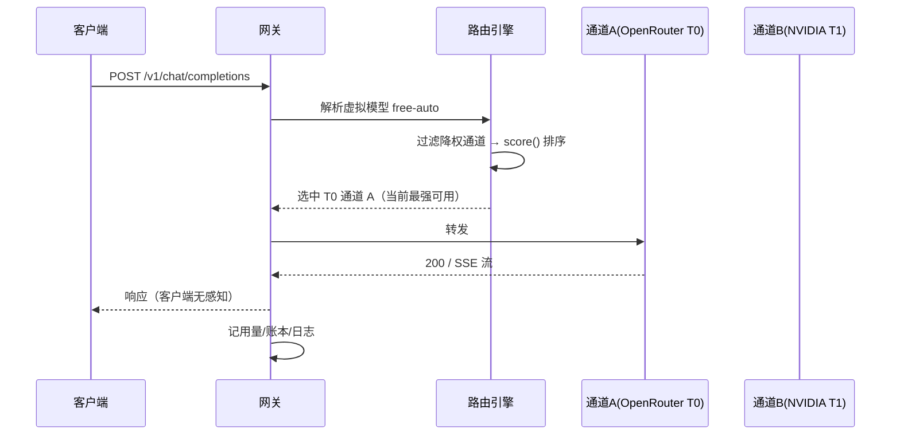
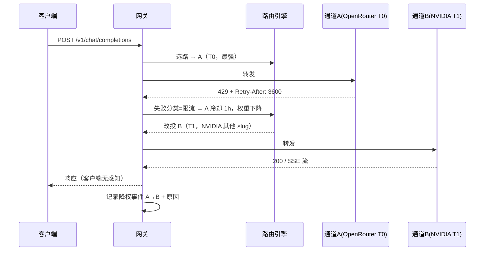

# 免费资源 AI 智能聚合网关 产品需求文档（PRD）

| 项目 | 内容 |
| --- | --- |
| 版本 | v1.0 |
| 日期 | 2026-10-19 |
| 状态 | 待评审 |
| 参考项目 | [Routiform](https://github.com/linhnguyen-gt/Routiform)（MIT，TypeScript / Next.js / SQLite） |
| 输入文档 | 《大厂llm免费资源对接.pdf》 |
| 关键词 | AI 网关、免费额度聚合、智能路由、限流降权、自动故障转移 |

---

## 1. 背景与问题

### 1.1 现状

输入文档《大厂llm免费资源对接.pdf》盘点了 4 个可用的大厂免费 LLM 资源：

| 资源 | 免费额度 | 稳定性特征 | 定位 |
| --- | --- | --- | --- |
| **OpenRouter** | 20+ `:free` 模型；基础 20 RPM / 50 RPD，充值 $10 后账户级永久 1,000 RPD | 无 SLA，可能超时/冷却；**同一模型背后多家上游，内置自动故障转移** | 聚合入口（广度 + 便利） |
| **NVIDIA NIM** | 每模型 40 RPM，且**按模型独立计费**；9 个模型 slug 级联理论 ≈360 RPM | 无 SLA，高峰 p99 可达数百秒 | 高吞吐批量层（额度最宽裕） |
| **Groq** | llama-3.1-8b-instant 14,400 RPD；llama-3.3-70b 1,000 RPD / 30 RPM；qwen3-32b、kimi-k2 60 RPM / 1,000 RPD | LPU 硬件，Llama 3.3 70B ≈320 tokens/s，延迟确定性最强 | 速度专用通道（交互场景） |
| **Cloudflare Workers AI** | 每天 10,000 Neurons | 边缘网络可用性基线高；大模型需付费计划 | 轻量/嵌入补充通道 |

### 1.2 核心问题

1. **额度碎片化**：每个免费源独立的 RPM/RPD 限制，单源直连迟早撞墙（如 OpenRouter 免费层 50 RPD 一天就见底）。
2. **切换靠人工**：429 限流、日限额耗尽、上游抖动时，需要人工改客户端配置换源，体验断裂。
3. **客户端耦合**：每个工具（Cursor / Cline / Claude Code 等）都要单独配一遍 Key 和 Base URL，接入成本高。
4. **最优模型不固定**：文档结论——"先看广度，再叠加吞吐与速度，让流量在源之间流动"，靠人工调度无法持续。

### 1.3 文档给出的组合策略（产品策略输入）

> 一个可落地的组合是：**OpenRouter 作为默认路由 → 命中 429 或额度耗尽时，回退到 NVIDIA NIM 级联（批量任务）或 Groq（交互任务）**。

这正是本产品要自动化实现的核心逻辑，并借鉴 Routiform 的工程实现把它做"智能"。

---

## 2. 产品定位与目标

### 2.1 一句话定位

**一个自托管的 AI 聚合网关：对内聚合 4 个免费资源（可扩展），对外只暴露一个 OpenAI 兼容端点；智能路由优先使用能力最强的模型，被降权（限流/故障）后自动切换到下一个可用通道，客户端全程无感知。**

### 2.2 产品目标

| 目标 | 衡量指标 |
| --- | --- |
| 客户端零改造成本 | 任何 OpenAI 兼容工具只改 `base_url` + `key` 两项即可接入 |
| 免费额度利用率最大化 | 相比单源直连，综合有效吞吐 ≥ 3 倍（NVIDIA 9 slug 级联 + 四源互补） |
| 服务不中断 | 任一上游 429/5xx/超时，客户端可见错误率 < 1%；24h 连续运行无人工干预 |
| 智能选路 | 默认路由到当前**能力档位最高**的可用通道；降权后自动切换，冷却结束自动探测恢复 |
| 可解释 | 每一次选路、降权、切换都有日志与事件流，可回溯 |

### 2.3 非目标（Out of Scope）

- 不做付费中转、不做计费、不做多租户 SaaS。
- 不接管 OAuth 类订阅源（Claude Code / Copilot 等），第一期仅 API Key 类免费源。
- 不做模型训练/微调，仅做推理网关。

---

## 3. 用户画像与典型场景

| 用户 | 诉求 | 典型场景 |
| --- | --- | --- |
| 个人开发者 | 免费、稳定地用上大模型 | Cursor / Cline 编程助手全天在线；日常问答 |
| 批量任务执行者 | 把免费额度"用尽" | 文档摘要、数据清洗等可排队任务，NVIDIA 级联灌满 360 RPM |
| 极客/自托管玩家 | 统一管理多个 Key，可观测 | Dashboard 看每个源的剩余额度、成功率、延迟 |

**场景定义（供路由策略使用）：**

- **S1 交互场景**：`stream: true` 且上下文较短 → 首选 **Groq**（速度确定性）。
- **S2 批量场景**：可排队、容忍数百秒延迟 → 首选 **NVIDIA NIM 级联**（吞吐最大）。
- **S3 通用/质量场景**：默认 → 首选 **OpenRouter**（广度 + 内置故障转移）。
- **S4 轻量场景**：嵌入、分类、ASR → 路由 **Cloudflare Workers AI**。

---

## 4. 参考项目 Routiform 技术借鉴分析

Routiform 是一个自托管的智能 AI 路由器（Next.js + TypeScript + SQLite，`/v1/*` OpenAI 兼容端点，59 个内置 provider）。本项目借鉴其**路由与韧性**核心设计：

| Routiform 组件/机制 | 本项目借鉴点 |
| --- | --- |
| 统一 OpenAI 兼容网关 `/v1/*` | 对外 API 形态完全一致：chat/completions、embeddings、models 等 |
| **Combo 路由**（有序模型链 + fallback） | 核心路由结构：候选通道按序尝试、失败即切换；同源多模型可互为后备 |
| **账号级 fallback**（`accountFallback.ts`） | 429 处理：**优先解析 `Retry-After` / `x-ratelimit-reset` 响应头**决定冷却时长，而非正文启发式；连续失败指数退避 1s→2min |
| **错误分类**（signals.ts） | 区分四类故障：限流（可恢复）、额度耗尽（按重置周期）、模型下线（永久剔除）、Key 失效（账户级），不同故障不同动作 |
| **Circuit Breaker** | CLOSED / HALF_OPEN / OPEN 三态：OPEN 自动排除，HALF 放行探测请求 |
| **Auto-Combo 引擎** | 6 因子评分选路（Quota/Health/CostInv/LatencyInv/TaskFit/Stability）+ 模式包（Speed/Economy/Quality/Availability）+ 自愈（临时排除、探测恢复、incident 模式）+ 5% bandit 探索 |
| Strategy 模式执行器（BaseExecutor） | 每个上游一个执行器，统一 URL/Header/重试/流式处理；新源接入只加一个执行器 |
| SQLite + write-through 状态持久化 | 冷却、熔断、配额账本重启不丢 |
| 全局路由策略（fill-first / round-robin / p2c / least-used / cost-optimized） | 提供可配置的选路策略基线 |

**借鉴后需要针对本项目改造的地方：**

1. Routiform 的 CostInv 因子面向付费定价；本项目全部免费 → 权重让位给 **能力档位（capability）** 与 **剩余额度（quota）**。
2. Routiform 的熔断面向"账号"，本项目的天然粒度是 **Provider × Model Slug 构成的"通道"**（NVIDIA 的 40 RPM 是按模型算的，必须按 slug 拆通道）。
3. 增加"**软降权**"：RPD 用量到 80% 即提前降权，避免真的 429 打门。

---

## 5. 系统架构设计

```
┌─────────────────────────────────────────────────────────────┐
│                        客户端层                              │
│   Cursor / Cline / Claude Code / OpenAI SDK / 自研应用        │
└───────────────────────┬─────────────────────────────────────┘
                        │ OpenAI 兼容协议（改 base_url 即接入）
                        ▼
┌─────────────────────────────────────────────────────────────┐
│                    AI 聚合网关（自托管）                        │
│  ┌────────────┐ ┌────────────┐ ┌────────────┐ ┌───────────┐ │
│  │ 统一 API 层 │ │ 智能路由    │ │  Provider  │ │  管理面    │ │
│  │ /v1/*      │ │  引擎       │ │  注册表     │ │ Dashboard │ │
│  │ 翻译/透传  │ │ 评分/降权   │ │ 4 免费源   │ │ CLI/API   │ │
│  │ 流式 SSE   │ │ 熔断/探测   │ │ + 自定义源 │ │           │ │
│  └────────────┘ └─────┬──────┘ └────────────┘ └───────────┘ │
│                       │          ┌─────────────┐            │
│                       │          │  SQLite     │            │
│                       │          │ 配置/状态/  │            │
│                       │          │ 用量/日志   │            │
│                       │          └─────────────┘            │
└───────────────────────┼─────────────────────────────────────┘
                        ▼
     OpenRouter    NVIDIA NIM×9     Groq      Cloudflare     （自定义源）
    （默认/质量）   （批量级联）   （速度）   （轻量/嵌入）
```

### 5.1 核心概念模型

- **Provider（源）**：一个上游厂商，含 Base URL、认证方式、模型同步能力。
- **通道（Channel）**：`Provider × Model Slug` 的最小计费/熔断单元。NVIDIA 的 9 个 slug 就是 9 个独立通道（各自 40 RPM）。
- **候选池（Candidate Pool）**：每个虚拟模型对应一组通道。
- **虚拟模型（Virtual Model）**：对客户端暴露的名字，如 `free-auto`、`free-strong`、`free-fast`、`free-batch`、`free-embed`。客户端不感知背后是哪个免费源。
- **配额账本（Quota Ledger）**：每通道当日已用 RPM/RPD、下次重置时间（从响应头学习）。

---

## 6. 功能需求详述

### F1 统一网关 API（P0）

| 编号 | 需求 | 验收标准 |
| --- | --- | --- |
| F1.1 | 暴露 OpenAI 兼容 `POST /v1/chat/completions`，流式（SSE）+ 非流式 | Cursor/Cline/任意 OpenAI SDK 直接可用 |
| F1.2 | `POST /v1/embeddings`（Cloudflare / 免费嵌入模型） | 返回标准 embeddings 结构 |
| F1.3 | `GET /v1/models` 列出虚拟模型目录（带能力档位说明） | 客户端可枚举 |
| F1.4 | 请求/响应翻译层：OpenAI 为枢纽格式，各源格式差异在 Provider 执行器内消化 | 接入新源不改客户端 |
| F1.5 | 流式透传：首包不缓冲、SSE 增量转发、断连即取消上游 | 流式延迟与直连无感知差异 |

### F2 Provider 接入管理（P0）

| 编号 | 需求 | 验收标准 |
| --- | --- | --- |
| F2.1 | 内置 4 个免费源注册表（OpenRouter / NVIDIA NIM / Groq / Cloudflare Workers AI），只需填 API Key | 添加 Key 后一键测试连通 |
| F2.2 | 每源支持多个 API Key（多账户轮换） | OpenRouter 主号 + 充值小号共存 |
| F2.3 | 在线同步上游 `GET /v1/models`，自动标记免费模型（`:free` 等） | 新上游模型自动进入候选池 |
| F2.4 | 自定义 OpenAI 兼容源（Base URL + Key） | 未来接入新免费源零代码 |
| F2.5 | Key 加密存储（`STORAGE_ENCRYPTION_KEY`） | 不明文落库 |

### F3 智能路由引擎（P0，核心）

> 设计原则：**先选能力最强的；被降权后换一个；冷却结束探测恢复。**

#### F3.1 能力分级（Capability Tiers）

每个通道按模型能力标注 `T0/T1/T2`（内置校准表 + 人工可调）：

| 档位 | 模型示例（来自输入文档） |
| --- | --- |
| T0 | Nemotron 3 Ultra (550B)、Nemotron 3 Super、Llama 3.3 70B、gpt-oss-120b、Qwen3-30B-A3B、DeepSeek R1 Distill、Gemini 2.0 Flash Exp |
| T1 | Llama 4 Scout/Maverick、Qwen3-14B/8B、Mixtral 8x22B、glm-5-3、nemotron-3.5-lightning |
| T2 | llama-3.1-8b 系列、gemma 系列、qwen2.5-coder、whisper（转写专属） |

#### F3.2 通道评分函数（借鉴 Auto-Combo 6 因子，权重重新标定为"能力优先"）

```
score(channel) = w_cap     × 能力档位分（T0=1.0, T1=0.6, T2=0.3）
               + w_quota   × 剩余配额归一化 [0..1]
               + w_health  × 熔断健康度（CLOSED=1.0, HALF=0.5, OPEN=0.0）
               + w_latency × p95 延迟倒数归一化
               + w_stab    × 近期成功率
               + w_scene   × 场景匹配度（交互/批量/嵌入/通用）
```

| 因子 | 默认权重 | 说明 |
| --- | --- | --- |
| cap（能力） | **0.30** | "先选能力强的"核心权重 |
| quota（剩余额度） | 0.25 | 引导流量避开即将耗尽的通道 |
| health（健康） | 0.20 | 熔断器状态 |
| latency（延迟） | 0.10 | p95 统计 |
| scene（场景） | 0.10 | S1 交互给 Groq 加分，S2 批量给 NVIDIA 加分 |
| stab（稳定性） | 0.05 | 成功率方差 |

**模式包（Mode Pack）一键切换：**

| 模式包 | 关键权重 | 适用 |
| --- | --- | --- |
| Quality First（默认） | cap=0.45 | 问答、代码等质量优先 |
| Ship Fast | latency=0.35 | IDE 交互、实时对话 |
| Batch Throughput | quota=0.45 | 离线批量，配合 NVIDIA 级联 |

#### F3.3 选路流程（每次请求）

```
1. 解析虚拟模型 → 候选通道集 C
2. 过滤：剔除 OPEN 熔断 / 冷却中的通道
3. 按 score(C) 降序排序
4. 取第一名尝试；失败进入降级循环（F3.4）
5. C 全部不可用 → 跨档降级（更低 Tier 候选池）→ 仍失败返回错误
6. 记录选路决策到请求日志（可解释）
```

#### F3.4 降权与切换（"被降权后换一个"的完整定义）

| 触发条件 | 判定 | 动作 |
| --- | --- | --- |
| HTTP 429 | 限流 | **解析 `Retry-After` / `x-ratelimit-reset` 头** → 该通道冷却至重置时间；无头则指数退避（1s→2min 封顶） |
| 429 且日限额耗尽（RPD 用尽） | 本日降权 | 冷却至次日额度重置时间 |
| HTTP 5xx / 超时 / 连接错误 | 临时故障 | 记一次失败；连续失败 N 次（默认 3）→ 熔断 OPEN（30s） |
| 模型下线（404） | 永久剔除 | 通道标记 permanent-lockout，移出候选池，不自动恢复 |
| 401/403 Key 失效 | 账户级故障 | 该 Key 账户降权，同源其他 Key 继续 |

**切换语义**：触发降权后，**同一请求立即在候选集中改投下一名**，不向客户端返回错误；流式响应已开始吐字则不切换（防内容撕裂），记为日志事件。

#### F3.5 探测恢复（Recovery）

- 冷却到期的通道进入 HALF_OPEN：放行 1 个探测请求（缩短超时）。
- 探测成功 → 恢复 CLOSED，权重复位；失败 → 冷却延长（×2，封顶 30min）。
- 高档位通道恢复后，流量自然回迁到能力最强通道。

#### F3.6 配额账本与软降权（Quota Ledger）

- 每通道维护：当日已用 RPM、RPD、下次重置时间（从响应头学习）。
- **软降权**：已用 RPD ≥ 80% → 提前降低该通道权重，把流量导向充裕通道，避免真的 429 打门。
- **NVIDIA 级联**：9 个 slug 独立记账，fill-first 填充，把 40 RPM/模型用满到约 360 RPM 总量。

#### F3.7 探索（Exploration）

- 5% 流量随机探询低分通道（bandit），保持对新免费模型的感知。
- 全部通道 OPEN（incident 模式）时自动关闭探索。

### F4 场景分流策略（P1）

| 场景 | 判定 | 路由倾向 |
| --- | --- | --- |
| S1 交互对话 | `stream: true` 且上下文 < 32k | Ship Fast → Groq 优先 |
| S2 批量任务 | 客户端头 `X-Gateway-Mode: batch` 或无 stream | Batch Throughput → NVIDIA 级联填充 |
| S3 嵌入/ASR | `/v1/embeddings` 或 whisper 模型 | Cloudflare Workers AI |
| 默认 | 其他 | Quality First → OpenRouter 广度入口 |

### F5 可观测性（P1）

| 编号 | 需求 |
| --- | --- |
| F5.1 | 请求日志：通道 / 模型 / 延迟 / 状态 / 用量 / 失败原因 / 选路决策 |
| F5.2 | 用量面板：按源、按模型、按日的 tokens / 请求数 / 成功率 |
| F5.3 | 延迟面板：p50/p95/p99（整体 + 分通道） |
| F5.4 | 健康面板：每通道剩余额度、冷却剩余时间、熔断状态、近期错误 |
| F5.5 | 降权事件流：每次自动切换记录「原通道 → 新通道 + 原因」，便于调参 |

### F6 管理面（P1）

| 编号 | 需求 |
| --- | --- |
| F6.1 | Web Dashboard：Provider 管理、模型目录、通道健康、用量、日志、模式包切换 |
| F6.2 | CLI：`gateway provider add/test`、`gateway status`、`gateway usage`、`gateway logs` |
| F6.3 | 管理 API（Bearer 鉴权）：配置 CRUD，便于脚本化 |
| F6.4 | 客户端 API Key 管理：签发 / 吊销 / 按 Key 限流 / 按 Key 用量隔离 |

### F7 安全与可靠性（P0）

| 编号 | 需求 |
| --- | --- |
| F7.1 | 网关对外 API Key 鉴权；上游 Key 加密存储 |
| F7.2 | 客户端限流：按 Key RPM/RPD，防止单个客户端打爆上游免费额度 |
| F7.3 | 敏感信息脱敏：日志不记录 Key；完整 prompt 落盘可配置 |
| F7.4 | 出站代理支持（`HTTPS_PROXY`）——免费源均在海外，国内部署必须 |
| F7.5 | 冷启动恢复：SQLite 持久化通道状态 / 冷却 / 熔断 / 配额账本，重启不丢降权记忆 |

---

## 7. 核心流程时序图

### 7.1 正常请求（默认路由到能力最强通道）



### 7.2 限流降权与自动切换



---

## 8. 数据模型（SQLite）

| 表 | 关键字段 | 说明 |
| --- | --- | --- |
| `providers` | id, name, type, base_url, api_key_enc, status | 4 个免费源 + 自定义源 |
| `channels` | id, provider_id, model_slug, capability_tier, weight, rpm_limit, rpd_limit, status | **Provider × Model 为一通道** |
| `channel_state` | channel_id, circuit(closed/half/open), cooldown_until, fail_streak, today_requests, today_tokens, reset_at | 降权记忆（write-through，重启恢复） |
| `client_keys` | id, key_hmac, name, rpm_limit, rpd_limit | 客户端 API Key |
| `virtual_models` | name, description, candidate_rule(JSON), mode_pack | 虚拟模型目录 |
| `request_logs` | id, ts, client_key_id, virtual_model, channel_id, model_slug, latency_ms, status, tokens, fallback_from, error_class | 请求全链路 |
| `usage_daily` | date, channel_id, requests, tokens, success_rate, p50/p95/p99 | 用量聚合 |

---

## 9. 对外 API 设计（摘要）

| 端点 | 用途 |
| --- | --- |
| `POST /v1/chat/completions` | 对话（核心） |
| `POST /v1/embeddings` | 嵌入 |
| `GET /v1/models` | 虚拟模型目录 |
| `GET /api/gateway/channels` | 通道健康 / 额度 / 冷却状态 |
| `GET /api/gateway/usage?range=7d` | 用量统计 |
| `GET /api/gateway/events` | 降权事件流 |
| `POST /api/providers/{id}/test` | 源连通性测试 |

客户端可选请求头：`X-Gateway-Mode: auto|interactive|batch|embed`，缺省 `auto`。

---

## 10. 非功能需求

| 类别 | 要求 |
| --- | --- |
| 可用性 | 单机部署；单一上游故障不影响网关服务本身；客户端可见错误率 < 1% |
| 性能 | 网关自身转发开销 P95 < 50ms；流式首包透传不缓冲 |
| 并发 | 单实例支持 200 并发 SSE 连接 |
| 额度效率 | 相比单源直连，免费额度综合利用率提升 ≥ 3 倍 |
| 可恢复 | 重启后冷却 / 熔断 / 配额账本状态不丢失 |
| 部署 | Docker 一键；Node ≥ 22；SQLite 零外部依赖 |
| 扩展 | 新免费源接入 = 一条 Provider 配置 + 能力分级标注，无需代码 |

---

## 11. 里程碑规划

| 阶段 | 周期 | 交付 | 出口标准 |
| --- | --- | --- | --- |
| **M1 MVP** | 第 1–2 周 | 统一网关 + 4 源接入 + 静态候选链（OpenRouter → NVIDIA → Groq）+ 429 切换 + SQLite 持久化 | 接入 Cursor/Cline 连续 24h 跑批无人工干预 |
| **M2 智能路由** | 第 3–4 周 | 能力分级 + 6 因子评分 + 冷却 / 熔断 / 探测恢复 + 配额账本 + NVIDIA 9-slug 级联 | 429 自动切换成功率 ≥ 99%；额度利用率 ≥ 3× |
| **M3 可观测** | 第 5 周 | Dashboard + CLI + 用量 / 健康 / 事件流 + 模式包切换 | 每次降权事件可追溯、可解释 |
| **M4 打磨** | 第 6 周 | 场景分流、探索流量、安全加固（Key 加密、客户端限流、代理支持）、性能压测 | 200 并发 SSE P95 达标 |

---

## 12. 风险与对策

| 风险 | 影响 | 对策 |
| --- | --- | --- |
| 免费源政策变更（额度收紧 / 模型下线） | 聚合价值下降 | 永久剔除机制 + 自定义源零代码接入 + 虚拟模型目录屏蔽上游变化 |
| OpenRouter 免费层不稳（无 SLA） | 默认入口抖动 | 不依赖单源：T0 档内多通道互备 + 冷却切换 + 探测恢复 |
| NVIDIA NIM 高峰 p99 数百秒 | 交互场景卡顿 | 场景分流：交互请求不进 NVIDIA；超时归为临时故障并切换 |
| 429 打门导致整体降级 | 体验下降 | 80% 阈值软降权 + `Retry-After` 精确冷却 |
| 流式中途切换造成内容撕裂 | 数据质量 | 已吐字不切换；仅首包前失败时重试 |
| 上游 Key 泄露 | 资产损失 | 加密存储 + 日志脱敏 + 客户端 Key 与上游 Key 隔离 |

---

## 13. 附录

### 13.1 术语表

| 术语 | 定义 |
| --- | --- |
| 通道（Channel） | `Provider × Model Slug` 组合，独立配额账本与健康状态 |
| 虚拟模型（Virtual Model） | 网关对客户端暴露的能力抽象（free-auto / strong / fast / batch / embed） |
| 降权（Degrade） | 通道因限流 / 故障被暂时排除出候选池，进入冷却 |
| 熔断（Circuit Breaker） | CLOSED / HALF_OPEN / OPEN 三态健康管理 |
| 级联（Cascade） | 同账户多模型 slug 顺序填充，放大免费吞吐上限 |

### 13.2 参考资料

- Routiform 项目：<https://github.com/linhnguyen-gt/Routiform>（架构文档、Auto-Combo 引擎）
- NVIDIA NIM 级联参考实现：<https://github.com/sergeykrin9/nvidia-nim-cascade>
- OpenRouter 免费模型列表：<https://openrouter.ai/models?max_price=0>
- NVIDIA 模型库：<https://build.nvidia.com/models>
- 输入文档：《大厂llm免费资源对接.pdf》

---

## 14. 待确认问题（Open Questions）

1. 部署形态：仅 Docker 自托管，还是同时提供 npm 全局安装（影响 M4 交付范围）？
2. 多账户策略：是否允许接入多个 OpenRouter 账号轮换（涉及上游 ToS，需评估）？
3. 智能路由默认模式包确认用 Quality First，还是按客户端类型自动判定？
4. 是否需要保留原始请求 / 响应落盘能力（合规审计场景）？
5. 优先级确认：F4 场景分流与 F5 可观测性是否可在 M2 并行提前？
